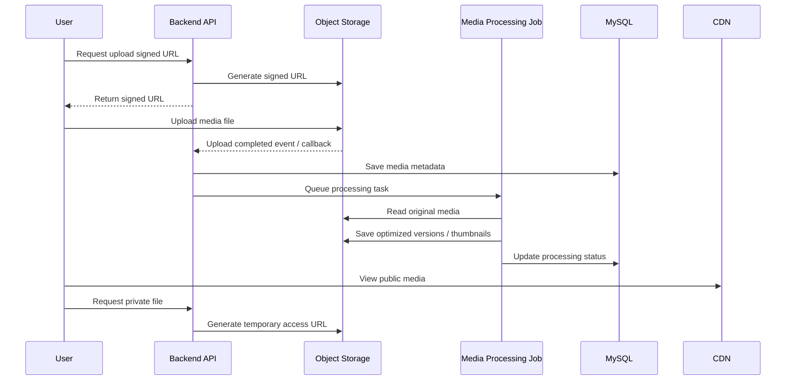

# Architecture
# المعمارية التقنية المقترحة لـ{{PROJECT_NAME}}

> هذا الملف هو المرجع الفني الأساسي لمعمارية مشروع {{PROJECT_NAME}}.
> يستخدمه فريق التطوير وDevOps وQA ووكلاء الذكاء الاصطناعي عند بناء النظام، تجهيز البنية، تصميم APIs، إدارة الوسائط، وتطبيق ضوابط الأمن والخصوصية.
>
> **قالب:** يُنسخ إلى `docs/03-development/architecture.md` وتُملأ المواضع `{{…}}`. القواعد المرتبطة بحزمة تقنية بعينها تُطبَّق عبر ملف تعريف الحزمة `profiles/<name>/`؛ الافتراضي `laravel-react` وهو ما تعكسه جداول الحزمة أدناه.

---

## 1. الغرض من الملف

يهدف هذا الملف إلى توثيق المعمارية التقنية المقترحة للمشروع، بما يشمل:

- القرار التقني الأساسي للمرحلة الأولى.
- أسلوب تقسيم النظام إلى موديولات تقنية.
- استراتيجية `Modular Monolith / Modular Services Ready`.
- البنية المقترحة على المنصة السحابية المعتمدة (`{{CLOUD_PROVIDER}}`).
- استراتيجية الصور والفيديو والتخزين السحابي.
- مبادئ الأمن والخصوصية وملكية الأصول.
- قابلية التوسع والفصل المستقبلي للخدمات.
- القرارات التقنية المفتوحة التي يجب حسمها قبل التنفيذ النهائي.

---

## 2. علاقة هذا الملف بباقي الوثائق

| الملف | العلاقة |
|---|---|
| `brd.md` | يحدد نطاق الأعمال ومتطلبات المنتج. |
| `module-registry.md` | يحدد الموديولات الرسمية واعتمادياتها. |
| `implementation-proposal.md` | يحتوي المرجع الأولي لخطة التنفيذ والمعمارية والتسعير. |
| `business-rules-global.md` | يحتوي القواعد العامة العابرة للموديولات. |
| `project-decisions.md` | يحتوي القرارات المعتمدة والقرارات المفتوحة. |
| `01-modules/{{integrations-module}}/` | حزمة موديول التكاملات — توثق تفاصيل التكاملات الخارجية. |
| `data-dictionary.md` | يوثق قاموس البيانات العام. |
| `api-contracts.md` لكل موديول | يوثق APIs التفصيلية لكل موديول. |
| `adr/` | سجلات القرارات المعمارية — `ADR-ARCH-001` سند الحزمة التقنية. |

---

## 3. القرار التقني الأساسي

### 3.1 النمط المعماري المعتمد

> **التصنيف: `{{STATUS}}`** — `ADR-ARCH-001`. يُعتمد النمط المعماري والحزمة التقنية رسميًا من مالك المنتج بـADR مستقل قبل أي بناء.

المعمارية المعتمدة للمشروع:

```text
Modular Monolith / Modular Services Ready
```

مع فصل كامل بين الواجهة الأمامية والخلفية (Frontend / Backend Separation).

وليس:

```text
Full Microservices
```

من اليوم الأول.

### 3.2 الحزمة التقنية المعتمدة

> **التصنيف: `{{STATUS}}`** — `ADR-ARCH-001`. الجداول أدناه تعكس الملف التعريفي الافتراضي `laravel-react`.

#### Frontend

| التقنية | الاستخدام |
|---|---|
| React | مكتبة بناء واجهة المستخدم |
| TypeScript | لغة الواجهة — تحقق ثابت من الأنواع قبل التشغيل |
| Vite | أداة البناء وخادم التطوير (HMR) |
| CSS3 | التنسيق والتصميم |
| Fetch / REST | الاتصال بـ Backend عبر REST APIs |

> **ملاحظة تنفيذية:** تُبنى الواجهة إلى ملفات ثابتة تُنشر مستقلة على `{{APP_DOMAIN}}`.
> متغيرات `VITE_*` تُحقن **وقت البناء** وتظهر في الحزمة المنشورة — فلا يجوز أن تحمل أي سر.

الواجهة الأمامية مستقلة تمامًا عن Backend:

- لا تحتوي على أي منطق Laravel أو PHP.
- جميع البيانات تُجلب من Backend عبر REST APIs فقط.
- لا يوجد Server-Side Rendering أو Laravel Blade.

#### Backend

| التقنية | الاستخدام |
|---|---|
| Laravel (Latest LTS) على PHP | إطار العمل الأساسي |
| REST API | واجهة الاتصال الوحيدة مع Frontend |
| Laravel Sanctum | المصادقة — رموز Bearer مبهمة (`AUTH-010`) |
| Modular Monolith Architecture | النمط المعماري |
| Service Layer | طبقة منطق الأعمال |
| Repository Pattern | طبقة الوصول للبيانات |
| Queue Jobs | المعالجة الخلفية (Laravel Queue) |
| Events | الأحداث الداخلية (Laravel Events) |
| Notifications | الإشعارات (Laravel Notifications) |

#### Database

| التقنية | الاستخدام |
|---|---|
| MySQL | قاعدة البيانات العلائقية الأساسية |

#### Cache & Sessions

| التقنية | الاستخدام |
|---|---|
| Redis | Cache |
| Redis | Sessions |
| Redis | Queue Driver |
| Redis | Rate Limiting |

#### Storage

| التقنية | الاستخدام |
|---|---|
| Object Storage (`{{OBJECT_STORAGE}}`) | الصور، الفيديو، المستندات، ملفات PDF، المرفقات |

لا يتم تخزين الوسائط داخل السيرفر.

#### Environment

| التقنية | الاستخدام |
|---|---|
| Docker Compose | البيئة المحلية (حزمة التطوير) وحزمة الاختبار المعزولة بقاعدة مستقلة |

### 3.3 سبب القرار

استخدام `Full Microservices` من بداية المشروع سيزيد بشكل واضح:

- تكلفة DevOps.
- تعقيد الاختبار.
- تعقيد النشر.
- متطلبات المراقبة.
- إدارة الشبكات والأمان بين الخدمات.
- احتمالية التأخير قبل موعد الإطلاق المستهدف.

بينما تمنح `Modular Architecture` مع فصل Frontend/Backend مزايا مهمة:

- سرعة أعلى في الإطلاق.
- تكلفة تشغيل أقل في البداية.
- سهولة اختبار وتشغيل MVP.
- فصل منطقي واضح داخل الكود.
- قابلية فصل الخدمات لاحقًا عند وجود ضغط أو نمو حقيقي.
- توافق أفضل مع هدف الإطلاق المستهدف.
- إمكانية استبدال الواجهة مستقبلًا دون تعديل Backend.
- جاهزية فورية لتطبيقات الجوال عبر نفس الـ API.

### 3.4 تفسير النمط المعماري

المقصود بـ`Modular Monolith / Modular Services Ready` هو أن النظام يبدأ كتطبيق واحد أو مجموعة محدودة من الخدمات، لكن داخليًا يتم تنظيمه إلى موديولات مستقلة منطقيًا، بحيث يكون لكل موديول:

- نطاق أعمال واضح.
- طبقات كود منفصلة قدر الإمكان (Service Layer + Repository Pattern).
- نماذج بيانات واضحة.
- APIs أو Services داخلية محددة.
- قواعد أعمال محصورة داخل الموديول.
- اعتماديات معروفة على باقي الموديولات.
- إمكانية فصله لاحقًا كخدمة مستقلة عند الحاجة.

---

## 4. مبادئ التصميم المعماري

| المبدأ | الوصف |
|---|---|
| Cloud-based | المنصة تعمل بالكامل على بنية سحابية، والمقترح الأساسي `{{CLOUD_PROVIDER}}`. |
| Media Offloading | جميع الملفات والوسائط تحفظ خارج السيرفر في Object Storage. |
| Logical Modularization | كل الموديولات منفصلة منطقيًا داخل الكود وقاعدة البيانات قدر الإمكان. |
| API-first Architecture | الواجهة والخلفية مفصولتان بالكامل. جميع الاتصالات عبر REST APIs فقط. جاهزية فورية لتطبيقات الموبايل. |
| Frontend Independence | الواجهة الأمامية مستقلة تمامًا — لا تحتوي على منطق Laravel أو PHP. يمكن نشرها واستبدالها بشكل مستقل. |
| Event-driven Operations | العمليات الثقيلة مثل الإشعارات ومعالجة الصور والفيديو تنفذ عبر أحداث أو مهام خلفية. |
| Security by Design | تضمين IAM وSecrets وSigned URLs وAudit Logs وBackups من البداية. |
| Scalable Foundation | دعم التوسع العمودي والأفقي عند زيادة المستخدمين والمعاملات والوسائط. |
| Cost-aware Architecture | تجنب حلول مبالغ بها قبل التحقق من الاستخدام الفعلي. |
| Future Service Separation | تصميم الموديولات بحيث يمكن فصلها لاحقًا دون إعادة بناء كاملة. |

---

## 5. النمط المعماري العام

```text
Frontend (React + TypeScript + Vite — SPA)
        ↓  REST APIs (HTTPS)
Backend API (Laravel — Modular Monolith)
        ↓
Application Modules (Service Layer + Repository Pattern)
        ↓
MySQL + Redis + Object Storage + External Integrations
        ↓
CDN + Monitoring + Logging + Backups
```

```mermaid
flowchart TD
    Client[Frontend Web App — {{APP_DOMAIN}}] -->|REST API / HTTPS| API[Backend API — {{API_DOMAIN}}]
    Admin[Admin Panel — {{APP_DOMAIN}}/admin] -->|REST API / HTTPS| API

    API --> IAM[Identity & Access Module]
    API --> MED[Media Module]
    API --> PAY[Payment Module]
    API --> NTF[Notification Module]
    API --> ADM[Admin Module]
    API --> DOM1[{{DOMAIN_MODULE_1}}]
    API --> DOM2[{{DOMAIN_MODULE_2}}]

    API --> REDIS[(Redis — Cache / Sessions / Queue)]

    IAM --> DB[(MySQL)]
    PAY --> DB
    ADM --> DB
    DOM1 --> DB
    DOM2 --> DB

    MED --> OBJ[Object Storage]
    OBJ --> CDN[CDN]

    PAY --> PGW[Payment Gateway]
    NTF --> SMS[SMS Provider]
    NTF --> EMAIL[Email Provider]

    API --> LOG[Logging]
    API --> MON[Monitoring]
    DB --> BAK[Backups]
```

---

## 6. الموديولات التقنية

> `{{MODULE_REGISTRY}}` — يُملأ من `module-registry.md`: صف لكل موديول تقني بمسؤولياته وجاهزية فصله لاحقًا.

| الموديول التقني | المسؤوليات | جاهزية الفصل لاحقًا |
|---|---|---|
| `{{MODULE_NAME}} ({{MODULE_CODE}})` | `{{المسؤوليات الأساسية — ما يملكه وما يقدّمه لغيره}}` | `{{يمكن فصله لاحقًا / مرشح للفصل مبكرًا / يبقى قريبًا من النظام الأساسي}}` |

---

## 7. حدود كل موديول تقني

لكل موديول في §6 قسم يحدد **ما هو مسؤول عنه** و**ما لا يجب أن يحتويه**. الأقسام 7.1–7.5 تخص الوظائف المشتركة التي يملكها موديول واحد في كل مشروع (`governance/execution-instructions.md` — جدول ملكية الوظائف المشتركة)، و7.6 قالب لموديولات المجال.

### 7.1 Identity & Access Module

مسؤول عن التسجيل، تسجيل الدخول، OTP، إدارة الأدوار، إدارة الصلاحيات، التوثيق الأساسي والإضافي، إدارة الجلسات، وحذف أو تعطيل الحسابات.

لا يجب أن يحتوي على منطق المعاملات التجارية أو المدفوعات، لكنه يوفر الهوية والصلاحية اللازمة لها.

### 7.2 Media Module

مسؤول عن رفع الصور والفيديو والمرفقات، حفظ Metadata للوسائط، إدارة حالة المعالجة، إنشاء Thumbnails، ضغط الصور، إنتاج Preview للفيديو عند الحاجة، وإدارة الوصول الآمن للملفات.

لا يقرر وحده هل الصورة كافية لاعتماد كيان أو معاملة؛ القرار يعود للموديول المالك للعملية.

### 7.3 Payment Module

مسؤول عن ربط بوابة الدفع، الرسوم، المبالغ المحجوزة والتأمينات، الاسترداد، سجل المعاملات، معالجة Webhooks من بوابة الدفع، وحالات الدفع.

لا يحدد وحده قواعد الاسترداد التجارية؛ يستند إلى قواعد الأعمال في موديولات المجال المالكة للمعاملة.

### 7.4 Notification Module

مسؤول عن SMS، Email، In-App Notifications، قوالب الرسائل، أحداث الإشعارات، وحالات الإرسال.

لا يغير حالة عملية تجارية بناءً على نجاح الإشعار فقط.

### 7.5 Admin Module

مسؤول عن إدارة المستخدمين، مراجعة التوثيق، إدارة كيانات المجال ومعاملاته من لوحة الإدارة، إدارة المدفوعات، التقارير، Audit Log، والإعدادات.

يعد موديولًا تشغيليًا شاملًا لكنه لا يجب أن يكرر منطق الموديولات، بل يديرها عبر صلاحيات وواجهات تشغيلية.

### 7.6 `{{DOMAIN_MODULE}}` — قالب موديول المجال

مسؤول عن: `{{الكيانات التي يملكها · العمليات التي ينفذها · آلات الحالة التي يحكمها · ما يوفره لغيره عبر العقود المشتركة}}`.

لا يجب أن: `{{ما يعتمد فيه على موديول آخر — مثل: لا يعالج الدفع بنفسه بل يستدعي Payment Module · لا يخزن الوسائط بل يعتمد على Media Module · لا يرسل إشعارًا مباشرًا}}`.

---

## 8. البنية السحابية

> المنصة السحابية تُعتمد رسميًا بقرار (`DEC-INF-NNN`). الحزمة التقنية الأساسية معتمدة بـ`ADR-ARCH-001`. الوظائف معتمدة عبر متطلبات موديول البنية التحتية (`FR-{{INF_CODE}}-*`)؛ اختيار المنتج المحدد داخل المنصة السحابية لبعض المكوّنات **`PROPOSED` حتى يصدر ADR** (`HG-I-06`).

| المكوّن | الخدمة المعتمدة | الاستخدام | التصنيف | السند |
|---|---|---|---|---|
| Frontend Hosting | استضافة مستقلة (Static/CDN) | نشر الواجهة الأمامية بشكل مستقل عن Backend. | `{{STATUS}}` | `ADR-ARCH-001` |
| Application Hosting | `{{RUNTIME — حاويات مُدارة أو عنقود}}` | تشغيل Backend API والمهام الخلفية. | `OPEN` — `ARCH-OD-001` | ADR مطلوب |
| Database | MySQL (`{{MANAGED_DB_SERVICE}}`) | تخزين بيانات الموديولات. | `{{STATUS}}` | `ADR-ARCH-001` |
| Cache / Sessions / Queue | Redis (`{{MANAGED_REDIS_SERVICE}}`) | Cache، Sessions، Queue Driver، Rate Limiting. | `{{STATUS}}` | `ADR-ARCH-001` |
| Object Storage | `{{OBJECT_STORAGE}}` | الصور، الفيديوهات، التقارير، المرفقات. لا تخزين وسائط داخل السيرفر. | `{{STATUS}}` | `FR-{{INF_CODE}}-*` |
| CDN | `{{CDN}}` | تسريع تحميل الصور والملفات للمستخدمين. | `{{STATUS}}` | `FR-{{INF_CODE}}-*` |
| Messaging / Async | Laravel Queue (Redis Driver) + `{{MESSAGING_SERVICE}}` عند الحاجة | الإشعارات، معالجة الوسائط، العمليات الخلفية. | `{{STATUS}}` | `FR-{{INF_CODE}}-*` · `ADR-ARCH-001` |
| Secrets | `{{SECRET_MANAGER}}` | حفظ مفاتيح الدفع والـAPIs بطريقة آمنة. | `{{STATUS}}` | `FR-{{INF_CODE}}-*` |
| Monitoring | `{{MONITORING}}` + Logging | مراقبة الأداء والأخطاء والاستخدام. | `{{STATUS}}` | `FR-{{INF_CODE}}-*` |
| Backup | Database Backups + Storage Lifecycle | نسخ احتياطي واحتفاظ `{{BACKUP_RETENTION_DAYS}}` يومًا. | `{{STATUS}}` | `DEC-INF-NNN` |

---

## 9. بيئات التشغيل

| البيئة | الاستخدام | ملاحظات |
|---|---|---|
| Development | تطوير المزايا الجديدة والتجارب الداخلية. | لا تحتوي بيانات إنتاجية. |
| Staging / Testing | اختبار QA وUAT وتجهيز الإطلاق. | أقرب ما يمكن للإنتاج. |
| Production | بيئة المستخدمين الفعلية. | تخضع للمراقبة والنسخ الاحتياطي. |

قواعد عامة:

- لا تستخدم بيانات إنتاجية حقيقية في بيئة التطوير دون إخفاء أو إتلاف بيانات حساسة.
- أي تغيير على Production يجب أن يمر عبر عملية نشر واضحة.
- يجب فصل أسرار ومفاتيح كل بيئة.
- يجب أن يكون لكل بيئة إعدادات منفصلة لبوابة الدفع وSMS عند توفر Sandbox.

---

## 9A. استراتيجية الاستضافة والنشر

> **التصنيف: `{{STATUS}}`** — `ADR-ARCH-001`

### 9A.1 المعمارية العامة للاستضافة

```text
Frontend Hosting ({{APP_DOMAIN}})
        ↓  REST APIs (HTTPS)
Backend API ({{API_DOMAIN}})
        ↓
MySQL Database (خادم مستقل)
        ↓
Redis (Cache / Sessions / Queue)
        ↓
Object Storage (الوسائط والملفات)
        ↓
CDN (تسريع التحميل)
```

### 9A.2 النشر المستقل

| المكوّن | النطاق (مثال توضيحي) | ملاحظات |
|---|---|---|
| Frontend | `{{APP_DOMAIN}}` | يُنشر بشكل مستقل عن Backend. لا يحتوي على PHP أو Laravel. |
| Backend API | `{{API_DOMAIN}}` | Laravel REST API. يُنشر بشكل مستقل. |
| Database | خادم مستقل | MySQL على خادم منفصل. |
| Redis | خادم أو خدمة مُدارة | Cache، Sessions، Queue، Rate Limiting. |
| Storage | Object Storage | Bucket مخصص لكل بيئة. |

> أسماء النطاقات أعلاه أمثلة توضيحية فقط وليست قرار DNS نهائي.

### 9A.3 قواعد النشر

- يمكن نشر Frontend دون إعادة نشر Backend والعكس صحيح.
- كل مكوّن يملك Pipeline نشر مستقل.
- يجب أن يكون لكل بيئة (Development / Staging / Production) إعدادات منفصلة لجميع المكوّنات.
- جميع الاتصالات بين Frontend وBackend عبر HTTPS.

---

## 9B. فصل الواجهة الأمامية عن الخلفية — Frontend / Backend Separation

> **التصنيف: `{{STATUS}}`** — `ADR-ARCH-001`

### 9B.1 وصف القرار

الواجهة الأمامية مفصولة بالكامل عن الخلفية (Laravel REST API). لا يوجد Server-Side Rendering ولا Laravel Blade. جميع البيانات تُجلب عبر REST APIs.

### 9B.2 فوائد الفصل

| الفائدة | الوصف |
|---|---|
| فصل التطوير | يمكن لفريق الواجهة والخلفية العمل بشكل متوازٍ ومستقل. |
| سهولة الصيانة | تعديل الواجهة لا يتطلب تعديل Backend والعكس صحيح. |
| استبدال الواجهة مستقبلًا | يمكن استبدال الواجهة بتقنية أخرى (Vue, Flutter Web, …) دون تعديل Backend. |
| دعم تطبيقات الجوال | نفس REST APIs يمكن استهلاكها من تطبيقات iOS وAndroid مباشرة. |
| إعادة استخدام الـ API | يمكن لأطراف خارجية أو تطبيقات أخرى استهلاك نفس الـ API. |
| تحسين الأمان | Backend لا يقدم HTML — يقتصر على بيانات JSON عبر API محمي. تقليل مساحة الهجوم. |
| التوسع الأفقي | يمكن توسيع Frontend وBackend بشكل مستقل حسب الضغط. |
| النشر المستقل | نشر تحديث للواجهة لا يتطلب إعادة نشر Backend. |

---

## 10. استراتيجية الصور والفيديو والتخزين السحابي

إذا كان المشروع `Media Heavy` بطبيعته — يرفع المستخدمون صورًا كثيرة وربما فيديوهات للكيانات المنشورة — يجب التعامل مع الوسائط كجزء أساسي من المعمارية وليس كميزة ثانوية. القواعد التفصيلية في `file-media-contract-standard.md`.

---

## 11. مبادئ التخزين

- عدم تخزين الصور أو الفيديوهات داخل السيرفر أو قاعدة البيانات.
- استخدام Object Storage Buckets للملفات الأصلية والمحسنة.
- رفع الملفات من المستخدم إلى Object Storage عبر `Signed URLs` بدل المرور عبر السيرفر عند الإمكان.
- حفظ `Metadata` فقط داخل قاعدة البيانات:
  - الرابط.
  - الحجم.
  - النوع.
  - الكيان المرتبط.
  - الموديول المرتبط.
  - حالة المعالجة.
- استخدام CDN لعرض الصور والفيديوهات بشكل أسرع.
- اعتماد Lifecycle Policies للأرشفة أو الحذف حسب السياسات المستقبلية.
- حماية الوثائق الحساسة بروابط مؤقتة وصلاحيات وصول مناسبة.

---

## 12. Media Processing Pipeline

| الخطوة | الوصف | الهدف |
|---|---|---|
| Upload | المستخدم يطلب رابط رفع مؤقت ويرفع مباشرة إلى Object Storage. | تقليل الضغط على السيرفر. |
| Validation | التحقق من النوع والحجم وعدد الملفات. | منع الملفات غير المناسبة. |
| Image Optimization | إنشاء نسخ مضغوطة وThumbnails وربما WebP. | تقليل التكلفة وتسريع العرض. |
| Video Processing | تحويل الفيديو إلى صيغة مناسبة أو إنشاء Preview/Thumbnail. | تحسين تجربة المشاهدة. |
| Metadata Save | حفظ البيانات في قاعدة البيانات وربطها بالكيان المالك. | إدارة منظمة للوسائط. |
| Delivery | عرض الملفات عبر CDN أو Signed URLs حسب الخصوصية. | أمان وسرعة. |

---

## 13. حدود الملفات المعتمدة

> **التصنيف: `{{STATUS}}`** — الحدود تُعتمد بقرار مسجَّل في `project-decisions.md`، وقيمها الافتراضية قابلة للتعديل عبر موديول الإعدادات (`CS-004`). يُعلَّم القرار المعدِّل عند تغيير قيمة (`SUPERSEDED PARTIALLY`) ولا يُعاد كتابة القرار الأصلي.

| نوع الملف | الحد المعتمد | السند | ملاحظات |
|---|---|---|---|
| `{{FILE_TYPE}}` (صور إلزامية · صور إضافية · حجم الصورة · عدد الفيديو · مدة الفيديو · حجم الفيديو · صلاحية Signed URL · تقارير PDF · الوثائق والمرفقات) | `{{VALUE}}` | `DEC-*` | `{{…}}` |

---

## 14. مخطط تدفق الوسائط



---

## 15. الأمن والخصوصية والملكية

### 15.1 ملكية الأصول

يجب أن تكون كل أصول المشروع الأساسية باسم العميل أو الشركة المالكة للمشروع، وتشمل:

- حساب المنصة السحابية.
- الدومين.
- قواعد البيانات.
- التخزين.
- بوابات الدفع.
- SMS.
- حسابات متاجر التطبيقات مستقبلًا (Apple Developer · Google Developer).
- أي حسابات AI أو خدمات خارجية أساسية.

### 15.2 صلاحيات مزوّد التطوير

- يتم منح مزوّد التطوير صلاحيات تنفيذ وإدارة محددة خلال فترة التطوير والتشغيل التجريبي.
- يجب أن تكون الصلاحيات بالحد الأدنى اللازم.
- يتم توثيق الصلاحيات في سجل تسليم أو سجل وصول.
- يتم تسليم أو إلغاء الصلاحيات عند نهاية المرحلة أو حسب اتفاق التشغيل.

### 15.3 قواعد ملكية البيانات

- لا تحفظ بيانات العميل في حسابات شخصية أو غير مملوكة للمشروع.
- لا تستخدم مفاتيح أو حسابات شخصية للتشغيل الإنتاجي.
- لا تنتقل ملكية بيانات المشروع إلى مزود التطوير.
- يجب تسليم كل الحسابات والإعدادات والمفاتيح وفق آلية تسليم معتمدة.

---

## 16. ضوابط الأمن الأساسية

| المجال | الضابط |
|---|---|
| كلمات المرور | تشفير كلمات المرور بطريقة آمنة وعدم حفظها كنص صريح. |
| توثيق الجوال | استخدام OTP لتأكيد رقم الجوال. |
| الصلاحيات | اعتماد RBAC / Role-Based Access Control. |
| الأسرار | حفظ مفاتيح بوابة الدفع وSMS وAI في مدير الأسرار. |
| الملفات الخاصة | استخدام Signed URLs للوصول المؤقت للملفات الخاصة. |
| بيانات المالك | عدم إظهار بيانات المالك الشخصية أو معرّفاته الحساسة للعامة. |
| الإجراءات الحساسة | تسجيلها في Audit Log. |
| النسخ الاحتياطي | نسخ يومي واحتفاظ `{{BACKUP_RETENTION_DAYS}}` يومًا. |
| البيئات | فصل مفاتيح وأسرار التطوير والاختبار والإنتاج. |
| الاتصالات | استخدام HTTPS في واجهات الإنتاج. |

---

## 17. الخصوصية

### 17.1 بيانات لا تظهر للعامة

- بيانات المالك الشخصية.
- رقم الجوال.
- المعرّفات الحساسة للكيانات (مثل أرقام الشرائح والوثائق الرسمية).
- الوثائق الشخصية أو التجارية.
- مستندات التوثيق.
- وثائق أو بيانات الدفع.
- تفاصيل Audit Log.
- التقارير الخاصة إلا لصاحب الكيان أو من يصرح له النظام لاحقًا.

### 17.2 بيانات قد تظهر للعامة

حسب حالة النشر وسياسة الموديول:

- بيانات الكيان المنشور العامة.
- الصور العامة للكيان المنشور.
- معلومات الإعلان.
- الحالة العامة للمعاملة المنشورة.
- معلومات المتجر أو الخدمة المنشورة.
- بيانات مزودي الخدمة المسموح إظهارها لمستخدم مسجل وموثق وفق القرار.

---

## 18. Audit Log

> **التصنيف: `{{STATUS}}`** — موديول سجل التدقيق (`{{MODULE_CODE}}`) مالك. سجلات Audit Log ثابتة نهائيًا ولا تُحذف ولا تُعدَّل (`AUD-007`). مدة الاحتفاظ الافتراضية `{{AUDIT_RETENTION_MONTHS}}` شهرًا (`AUD-008`) قابلة للتعديل بصلاحية SYSADMIN عبر موديول الإعدادات.

يجب تسجيل الإجراءات الحساسة التالية كحد أدنى:

- اعتماد أو رفض توثيق مستخدم أو دور.
- تعليق أو تفعيل حساب.
- تعديل صلاحيات المستخدم.
- إنشاء أو إلغاء معاملة تجارية.
- تغيير حالات المعاملة.
- تغيير حالة توثيق كيان.
- إخفاء أو إعادة إظهار سجل.
- تعديل العمولات أو الرسوم أو الباقات.
- تعديل قيم المبالغ المحجوزة أو التأمينات.
- معالجة فشل الدفع.
- التحويل إلى طرف بديل في معاملة.
- تعديل الإعدادات الحساسة.

### 18.1 بيانات Audit Log المقترحة

| الحقل | الوصف |
|---|---|
| actor_id | المستخدم أو المدير الذي نفذ الإجراء. |
| actor_role | دور الفاعل عند تنفيذ الإجراء. |
| action | نوع الإجراء. |
| entity_type | نوع الكيان المتأثر. |
| entity_id | معرف الكيان المتأثر. |
| old_value | القيمة السابقة عند توفرها. |
| new_value | القيمة الجديدة عند توفرها. |
| reason | سبب أو ملاحظة عند الحاجة. |
| timestamp | وقت التنفيذ. |
| ip_address | عنوان IP عند توفره. |

> تفاصيل Data Model النهائية توثق في `audit-logging-standard.md` (`AUD-003`) وملفات الموديولات و`data-dictionary.md`.

---

## 19. النسخ الاحتياطي والاستعادة

### 19.1 السياسة المعتمدة

> **التصنيف: `{{STATUS}}`** — `DEC-INF-NNN`

- نسخ احتياطي يومي للبيانات التشغيلية.
- احتفاظ لمدة `{{BACKUP_RETENTION_DAYS}}` يومًا.
- RPO ≤ `{{RPO}}` مكفول بالنسخ اليومية.
- RTO: `{{RTO}}` — **`OPEN`** حتى يُحدَّد قبل الإطلاق التجاري؛ قبل ذلك الاستعادة بجهد معقول من DevOps بلا SLA.
- تخزين الوسائط ضمن سياسة تخزين منفصلة على Object Storage.
- لا يشمل MVP خطة Disaster Recovery متقدمة ما لم تُعتمد.

### 19.2 مكونات النسخ

| المكون | طريقة النسخ |
|---|---|
| MySQL | Database Backups (يومية + احتفاظ `{{BACKUP_RETENTION_DAYS}}` يومًا). |
| الوسائط | Storage Lifecycle / Bucket Versioning عند الحاجة. |
| ملفات PDF | Object Storage مع سياسة احتفاظ. |
| الإعدادات الحساسة | توثق وتدار عبر مدير الأسرار وسياسات الوصول. |
| الكود | مستودع Git مع CI/CD. |

---

## 20. التوسع والأداء

### 20.1 أهداف المرحلة الأولى

| المؤشر | الهدف |
|---|---|
| تحميل الصفحات الأساسية | `{{PAGE_LOAD_TARGET}}` كهدف تشغيلي. |
| التحديثات اللحظية (إن وُجدت) | `{{REALTIME_UPDATE_TARGET}}` كهدف تشغيلي. |
| المستخدمون المتزامنون | `{{CONCURRENT_USERS_TARGET}}` تقريبًا في المرحلة الأولى. |
| جلسة واحدة نشطة عالية التزامن | `{{USERS_PER_SESSION_TARGET}}` كهدف اختبار أولي. |

> هذه أهداف تشغيلية واختبارية وليست SLA تعاقديًا إلا إذا تم اعتمادها في العقد النهائي.

### 20.2 استراتيجية التوسع

- التوسع الرأسي عند الحاجة في قاعدة البيانات (MySQL).
- التوسع الأفقي لخدمات التطبيق عبر `{{RUNTIME}}`.
- التوسع الأفقي للواجهة الأمامية بشكل مستقل عن Backend.
- فصل Media Module عند ارتفاع حجم الوسائط والمعالجة.
- فصل موديول المجال عالي الضغط (`{{DOMAIN_MODULE}}`) عند ارتفاع التزامن فيه.
- فصل Notification Module عند ارتفاع حجم الإشعارات.
- فصل Payment Module عند الحاجة لامتثال مالي أو مراقبة مستقلة.
- Redis يوفر Cache Layer يقلل الضغط على MySQL.

### 20.3 الخصائص غير الوظيفية المعتمدة

> **التصنيف: `{{STATUS}}`** — تنعكس من `ADR-ARCH-001`

| الخاصية | الوصف |
|---|---|
| استقلالية الواجهة | Frontend مستقل تمامًا — يمكن تطويره ونشره واستبداله دون تأثير على Backend. |
| قابلية التوسع | كل مكوّن (Frontend, Backend, Database, Redis) قابل للتوسع بشكل مستقل. |
| سهولة النشر | كل مكوّن يُنشر بشكل مستقل مع Pipeline خاص. |
| سهولة الاختبار | يمكن اختبار Backend عبر API Tests بشكل مستقل عن Frontend. يمكن اختبار Frontend ضد Mock API. |
| High Availability | فصل المكوّنات يسمح بمعالجة فشل كل مكوّن بشكل مستقل. Redis يوفر Sessions مشتركة بين الخوادم. |
| API-First Architecture | جميع الوظائف متاحة عبر REST APIs — جاهزة لتطبيقات الجوال وأي عميل آخر. |

---

## 21. Event-driven and Background Jobs

### 21.1 الحالات المناسبة للمعالجة الخلفية

| الحالة | السبب |
|---|---|
| إرسال SMS أو Email | لا يجب أن يوقف تجربة المستخدم عند بطء المزود. |
| معالجة الصور | ضغط وإنشاء نسخ يحتاج وقتًا. |
| معالجة الفيديو | مكلف ويحتاج مهام منفصلة. |
| توليد PDF | يمكن تنفيذه كعملية خلفية عند الحاجة. |
| الإشعارات المجدولة والزمنية | تحتاج إدارة أحداث وزمن. |
| Webhooks الدفع | تحتاج معالجة موثوقة وإعادة محاولة عند الفشل. |

### 21.2 الأدوات المعتمدة

- Laravel Queue Jobs (Redis Driver) — المعالجة الخلفية الأساسية.
- Laravel Events — الأحداث الداخلية بين الموديولات.
- Laravel Notifications — قناة موحدة للإشعارات.
- Laravel Task Scheduling — المهام المجدولة.
- `{{MESSAGING_SERVICE}}` — عند الحاجة لمعالجة غير متزامنة خارج Laravel (يُحسم بـADR — `EP-SYNC-003`).

---

## 22. Integration Architecture

### 22.1 التكاملات الأساسية

> كل تكامل يُعتمد بقرار مسجَّل ويُوثَّق في حزمة موديول التكاملات. المزود يبقى **محايدًا تقنيًا** ما لم يُسمَّ بقرار؛ والتصميم يُجرَّد عن المزود (`EP-INT-003`).

| التكامل | الاستخدام | المرحلة | التصنيف | السند |
|---|---|---|---|---|
| Payment Gateway (`{{PROVIDER}}`) | الرسوم والمبالغ المحجوزة والتأمينات. العملة `{{CURRENCY}}`. | `{{PHASE}}` | `{{STATUS}}` | `DEC-*` · `FR-{{INT_CODE}}-*` |
| SMS Provider | OTP والإشعارات النصية. محايد تقنيًا — يُحدَّد في التنفيذ. | `{{PHASE}}` | `{{STATUS}}` | `DEC-*` · `FR-{{INT_CODE}}-*` |
| Email Provider | الرسائل والإشعارات. محايد تقنيًا — يدعم RTL. | `{{PHASE}}` | `{{STATUS}}` | `DEC-*` · `FR-{{INT_CODE}}-*` |
| WhatsApp Business API | OTP فقط إن اعتُمد. | `{{PHASE}}` | `{{STATUS}}` | `DEC-*` · `FR-{{INT_CODE}}-*` |
| Google/Apple OAuth | تسجيل دخول اجتماعي. تفعيل/تعطيل من لوحة الإدارة. | `{{PHASE}}` | `{{STATUS}}` | `DEC-*` · `FR-{{INT_CODE}}-*` |
| Object Storage | ملفات وصور وفيديو ومرفقات. | `{{PHASE}}` | `{{STATUS}}` | `FR-{{INF_CODE}}-*` |
| PDF Generation | التقارير عبر مكتبة خادمية داخلية. | `{{PHASE}}` | `{{STATUS}}` — المكتبة المحددة `OPEN` | `DEC-*` |
| QR Generation | التحقق من التقارير — صفحة عامة بلا تسجيل دخول. | `{{PHASE}}` | `{{STATUS}}` | `DEC-*` |
| `{{OTHER_INTEGRATION}}` | `{{…}}` | `{{PHASE}}` | `{{STATUS}}` | `DEC-*` |

### 22.2 مبادئ التكامل

- لا تستخدم حسابات شخصية في أي تكامل إنتاجي.
- يتم حفظ الأسرار في مدير الأسرار.
- يتم تسجيل Webhooks المهمة.
- يجب دعم Retry أو معالجة فشل للتكاملات الحرجة.
- يجب عزل تكامل الدفع منطقيًا داخل Payment Module.

---

## 23. CI/CD والنشر

### 23.1 المبادئ

- الاعتماد على مستودع Git مركزي.
- فصل فروع التطوير والاختبار والإنتاج حسب خطة الفريق.
- تشغيل اختبارات أساسية قبل النشر.
- نشر Staging قبل Production.
- حفظ سجل للإصدارات.
- القدرة على الرجوع للإصدار السابق عند الحاجة.

### 23.2 Pipeline مقترح

#### Frontend Pipeline

```text
Code Commit (Frontend Repo/Branch)
  ↓
Build (Vite → static bundle)
  ↓
Deploy to Staging ({{APP_STAGING_DOMAIN}})
  ↓
QA
  ↓
Deploy to Production ({{APP_DOMAIN}})
```

#### Backend Pipeline

```text
Code Commit (Backend Repo/Branch)
  ↓
Build + Automated Tests
  ↓
Deploy to Staging ({{API_STAGING_DOMAIN}})
  ↓
QA / UAT
  ↓
Approval
  ↓
Deploy to Production ({{API_DOMAIN}})
  ↓
Monitoring
```

> أسماء النطاقات أعلاه أمثلة توضيحية فقط.

---

## 24. المراقبة والتسجيل

### 24.1 Monitoring

يجب مراقبة:

- حالة التطبيق.
- استهلاك CPU/Memory.
- زمن الاستجابة.
- أخطاء API.
- فشل عمليات الدفع.
- فشل إرسال الإشعارات.
- فشل معالجة الوسائط.
- استهلاك التخزين.
- تكلفة الخدمات السحابية.

### 24.2 Logging

يجب تسجيل:

- أخطاء النظام.
- استثناءات APIs.
- نتائج Webhooks.
- فشل التكاملات.
- أحداث المعالجة الخلفية.
- تحذيرات الأداء.

> Logging التقني لا يغني عن `Audit Log` الخاص بالحوكمة.

---

## 25. حدود MVP التقنية

### 25.1 داخل MVP

- Frontend مستقل (React + TypeScript + Vite).
- Admin Panel.
- Backend API (Laravel — REST API).
- MySQL.
- Redis (Cache / Sessions / Queue / Rate Limiting).
- Object Storage للوسائط.
- CDN.
- بوابة دفع.
- SMS/Email/In-App Notifications.
- PDF + QR للتقارير (إن انطبق على المجال).
- Audit Log أساسي.
- Monitoring وLogging أساسيان.
- Backups يومية واحتفاظ `{{BACKUP_RETENTION_DAYS}}` يومًا.
- `{{PROJECT_SPECIFIC_MVP_ITEM}}`

### 25.2 خارج MVP

- Full Microservices.
- Mobile Native Apps.
- Wallet داخلي.
- AI Model مخصص ومدرب بالكامل.
- DR متقدم متعدد المناطق.
- نظام شكاوى ونزاعات متقدم.
- تكاملات رسمية غير مؤكدة.
- HA/SLA تعاقدي متقدم ما لم يعتمد لاحقًا.
- `{{PROJECT_SPECIFIC_OUT_OF_SCOPE_ITEM}}`

---

## 26. القرارات المعمارية — تصنيف محدّث

> يُراجع هذا القسم عند كل تدقيق: قرار مُدرج «مفتوحًا» وقد حُسم بقرار معتمد سابق يُنقل إلى 26.1 بسنده، ولا يبقى مفتوحًا بالوراثة.

### 26.1 قرارات مُغلقة (كانت مدرجة كمفتوحة خطأً)

| ID | القرار | الحالة | السند |
|---|---|---|---|
| ~~ARCH-OD-NNN~~ | `{{DECISION}}` | **مُغلق** — `{{RESOLUTION}}` | `DEC-*` |

### 26.2 قرارات مفتوحة

| ID | القرار المطلوب | السبب | الأثر | ملاحظات |
|---|---|---|---|---|
| ARCH-OD-001 | اختيار نمط تشغيل الخلفية (حاويات مُدارة أم عنقود) لمرحلة MVP | تحديد طريقة التشغيل والتكلفة والتعقيد. | DevOps، التكلفة، الإطلاق. | يُحسم بـADR قبل `cloud-architecture.md`. |
| ARCH-OD-NNN | تحديد RTO | RPO يُغلق بسياسة النسخ. RTO يُحدَّد قبل الإطلاق التجاري. | البنية، النسخ، التكلفة. | — |
| ARCH-OD-NNN | تحديد مكتبة PDF/QR المحددة | المبدأ: مكتبة خادمية داخلية. المكتبة المحددة مفتوحة. | الموديول المُصدِر للتقارير. | — |
| ARCH-OD-NNN | تحديد سياسة Lifecycle السحابية للوسائط | سياسات الاحتفاظ والإخفاء تُحسم بقرار؛ الأرشفة السحابية لا. | Media، الخصوصية، التكلفة. | — |
| ARCH-OD-NNN | `{{DECISION}}` | `{{…}}` | `{{…}}` | `{{…}}` |

### 26.3 العناصر البنيوية والمجالات العابرة — حالتها ومعيارها الحاكم

**العناصر البنيوية** (تُحسم بـ`ADR-ARCH-001` ولا يُبنى عليها قبله):

| المجال | الحالة | الملاحظة |
|---|---|---|
| النمط المعماري (Modular Monolith) | `{{STATUS}}` | `ADR-ARCH-001` |
| محرك قاعدة البيانات | `{{STATUS}}` — MySQL | `ADR-ARCH-001` |
| إطار العمل الخلفي (Laravel على PHP) | `{{STATUS}}` | `ADR-ARCH-001` |
| الواجهة الأمامية (React + TypeScript + Vite) | `{{STATUS}}` | `ADR-ARCH-001` |
| Cache / Sessions / Queue (Redis) | `{{STATUS}}` | `ADR-ARCH-001` |
| فصل Frontend / Backend | `{{STATUS}}` | `ADR-ARCH-001` |

**المجالات المعمارية العابرة** — لكلٍّ معيار حاكم في `standards/`؛ تُراجَع حالتها في المشروع **بقراءة المعيار المُحال إليه لا بالافتراض**، لأن وثيقة تقول «غير موجود» عن مجال صار معيارًا معتمدًا تتقادم بصمت:

| المجال | المعيار الحاكم | الحالة في المشروع |
|---|---|---|
| آلية النقل بين الخدمات (متزامن/غير متزامن) | `EP-SYNC-001..004` (`engineering-principles.md`) | `{{STATUS}}` |
| حدود المعاملات (Transaction Boundaries) | `EP-TXN-001..004` + `CS-019`/`CS-020` — المعاملة لا تتجاوز حدود الموديول، والأحداث تُنشر **بعد** الالتزام | `{{STATUS}}` |
| كتالوج الأحداث (Event Catalog) | `event-contract-standard.md` (`EVT-001..017`) + `cross-module-contract-registry.md` | `{{STATUS}}` |
| إصدارات API (API Versioning) | `API-005` (`/api/v{N}/{module-code}/...`) + `API-028` + فحص `RS-017` الآلي. **ما يبقى مفتوحًا:** سياسة الإهمال · مدة دعم الإصدار القديم · شروط `v2` | `{{STATUS}}` |
| Idempotency | `EP-IDEM-001..002` + `api-design-standard.md` + `CS-025` — مفتاح إلزامي لكل عملية مالية | `{{STATUS}}` |
| معالجة التزامن (Concurrency Control) | `EP-CONC-001..002` + `CS-026` — قفل صريح (`lockForUpdate`) | `{{STATUS}}` |
| Caching Strategy التفصيلية | Redis معتمد **كتقنية**؛ استراتيجية التخزين المؤقت لكل موديول (المفاتيح · الإبطال · مدة الصلاحية) تُكتب بقرار لكل موديول ولا تُعمَّم | `{{STATUS}}` — `OPEN` افتراضيًا |
| Correlation ID / Structured Logging | `Correlation ID` مُعرَّف (`AUD-003` · `EP-OBS-004`). `Structured Logging` العام بلا معيار مستقل | `{{STATUS}}` |

---

## 27. قواعد لوكلاء الذكاء الاصطناعي

- الحزمة التقنية المعتمدة: Laravel Backend + React + TypeScript + Vite Frontend + MySQL + Redis + Object Storage (`ADR-ARCH-001` · `profiles/laravel-react/`). لا تقترح بديلًا دون Change Request.
- لا تقترح Full Microservices كمعمارية MVP دون Change Request.
- لا تقترح Server-Side Rendering أو Laravel Blade — الواجهة مفصولة بالكامل عبر REST APIs.
- لا تقترح محرك قاعدة بيانات بديلًا — قاعدة البيانات المعتمدة هي MySQL (`ADR-ARCH-001`).
- الواجهة المعتمدة هي React + TypeScript + Vite. لا تقترح Vue.js أو Angular أو أي إطار بديل دون Change Request، ولا العودة إلى jQuery.
- متغيرات `VITE_*` تُحقن **وقت البناء** ولا يجوز أن تحمل أسرارًا.
- لا تضع الصور أو الفيديوهات داخل قاعدة البيانات أو داخل السيرفر.
- لا تنشئ API بدون مراجعة موديول الملكية في `module-registry.md`.
- بوابة الدفع المعتمدة هي ما سمّاه القرار (`DEC-*`). لا تقترح مزود بديل دون Change Request.
- مزود SMS/Email محايد تقنيًا ما لم يُسمَّ بقرار. لا تفترض مزودًا محددًا.
- حدود الوسائط المعتمدة هي ما سجّله القرار وتُقرأ من موديول الإعدادات. لا تتجاوزها دون Change Request.
- لا تكرر قواعد الأعمال داخل المعمارية؛ ارجع إلى `business-rules-global.md`.
- لا تستخدم بيانات حساسة في أمثلة أو Seed Data.
- لا تتعامل مع ميزة مصنَّفة `PROPOSED` أو «Readiness» كميزة إلزامية متقدمة في MVP.
- لا تفترض SLA أو DR متقدم دون اعتماد تعاقدي.
- استخدم Laravel Queue (Redis Driver) للمعالجة الخلفية — لا تفترض أداة أخرى دون حاجة واضحة.
- استخدم Repository Pattern وService Layer في كل موديول.

---

## 28. ADR-ARCH-001 — قرار المعمارية الأساسية

> **النصّ الكامل في ملف مستقل:** `adr/ADR-ARCH-001-technology-stack.md` (يُنشأ من `standards/adr/ADR-TEMPLATE.md`، ومثاله للملف التعريفي الافتراضي `standards/adr/ADR-ARCH-001-technology-stack.example.md`).
>
> **لماذا ملف مستقل:** سند الحزمة التقنية كلها يُحال إليه من عشرات الملفات؛ إن عاش قسمًا داخل هذه الوثيقة بلا ملف، فمن يبحث عن «ADR» لا يجد شيئًا. **ما يبقى هنا:** ملخّص القرار وحالته. **ما في الملف:** النصّ الأصلي + السياق + البدائل المرفوضة + الحالة التنفيذية.
>
> بندٌ يُستبدل لاحقًا (مثل تغيير مكدس الواجهة) يُعلَّم في الملف بإشعار استبدال جزئي ولا يُعاد كتابة النصّ — سجلات القرارات لا تُحرَّر بأثر رجعي.

### الملخّص

| العنصر | الحالة |
|---|---|
| النمط المعماري | **Modular Monolith** `{{STATUS}}` |
| محرك قاعدة البيانات | **MySQL** `{{STATUS}}` |
| إطار الخلفية | **Laravel على PHP** `{{STATUS}}` |
| الواجهة | **React + TypeScript + Vite** `{{STATUS}}` |
| Cache / Sessions / Queue | **Redis** `{{STATUS}}` |
| فصل Frontend / Backend | `{{STATUS}}` |
| البيئة المحلية | **Docker Compose** `{{STATUS}}` |

### الحالة

```text
{{STATUS}} — {{YYYY-MM-DD}}
```

---

## 29. سجل الإصدارات

| الإصدار | التاريخ | التغيير | الحالة |
|---|---|---|---|
| 0.1.0 | — | extracted from the reference project | DRAFT |

---

## 30. المراجع

- `00-product/implementation-proposal.md`
- `00-product/module-registry.md`
- `00-product/business-rules-global.md`
- `00-product/project-decisions.md`
- `00-product/glossary.md`
- `01-modules/{{integrations-module}}/` — حزمة موديول التكاملات
- `03-development/data-dictionary.md`
- `03-development/adr/` — سجلات القرارات المعمارية
